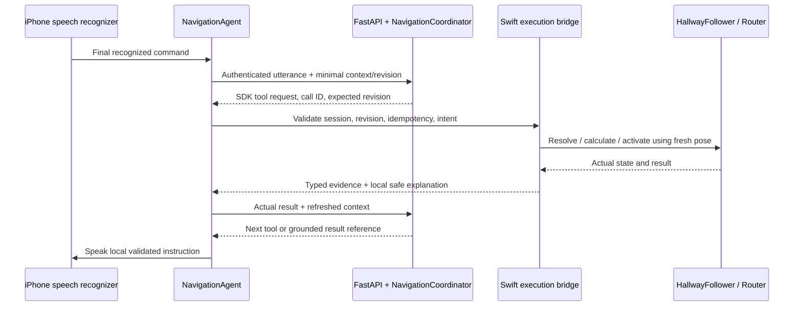

# Indoorbility agent backend

For Mac-independent deployment, use [the Railway deployment and phone test guide](../docs/RAILWAY_DEPLOYMENT.md). It documents durable storage, one-time phone pairing, renewable 15-minute access tokens, and the verification gate before enabling a production URL. The development-token/tunnel instructions below apply only to local development. Production rejects legacy development tokens.

This is a FastAPI + OpenAI Agents SDK coordinator, connected to native Swift tools. Real OpenAI calls and actual Swift routing mutations were verified on November 14, 2026 using a synthetic pose. Physical iPhone ARKit, speech and camera verification remains outstanding. See `../docs/IPHONE_AGENT_TEST.md` and `../docs/REAL_AGENT_VERIFICATION.json`. Offline tests use a deliberately scripted SDK model. They do not count as real inference.

## Configure and run

Use Python 3.11 or later (tested here with Python 3.14). From the project root:

```sh
python3 -m venv backend/.venv
backend/.venv/bin/pip install -r backend/requirements.lock.txt
cp -n backend/.env.example backend/.env
```

Edit **backend/.env** locally. Put your OpenAI API key in `OPENAI_API_KEY`. Select an available tool-calling model with `OPENAI_MODEL` (default `gpt-4.1-mini`; your project must have access). This workspace already has a generated `AGENT_AUTH_SECRET` in the ignored local `.env`. For a fresh checkout, generate `AGENT_AUTH_SECRET` with `python3 -c 'import secrets; print(secrets.token_urlsafe(48))'` and place it in that file. Never put either secret in the iOS app. `.env` is ignored. The Google Maps key is unrelated and is never read by this backend.

The backend automatically loads `backend/.env` without overriding existing environment variables. Run one worker:

```sh
backend/.venv/bin/uvicorn backend.app:app --host 127.0.0.1 --port 8765 --no-access-log
```

In a second terminal, issue a one-time phone pairing code:

```sh
backend/.venv/bin/python backend/device_auth.py
```

This operator command prints a pairing code valid for ten minutes. Enter it in the app's AI connection settings. It does not print the model key or server signing secret. One-time pairing creates a revocable device identity and renewable 15-minute access tokens and durable, rotating device credentials. `issue_token.py` is retained only for development probes; production rejects those legacy tokens. For public distribution, define an identity/enrollment policy beyond operator pairing.

## Connect a physical iPhone

1. Expose the loopback development server through a trusted HTTPS reverse proxy or HTTPS development tunnel. For example, if Cloudflare Tunnel is installed: `cloudflared tunnel --url http://127.0.0.1:8765`. Use the resulting HTTPS base URL. The service stays authenticated; do not remove authentication to make a tunnel work.
2. Build the existing Indoorbility target in Xcode onto the phone with your existing signing team.
3. Open **Settings → AI connection**, enable **Show agent timeline**, and open **Advanced connection**. Enter the HTTPS base URL (without `/agent/turn`) and the one-time pairing code. Tap **Pair this iPhone**, then turn developer mode off. Read the cloud data-sharing description before pairing.
4. Enable **Show agent timeline** for the demonstration. During navigation it appears under **More → Agent timeline**.
5. Do not enter `localhost` on a physical phone: that points to the phone, not your Mac. HTTPS is required by the client. No broad ATS exceptions or certificate-verification bypasses are added.

The cloud opt-in sends command text, a random session/map ID, known room labels, current instruction/tracking category, constraints, closures and explicitly requested OCR/depth evidence. No raw audio, images, pose coordinates/history, health information or full saved map is transmitted. OCR is untrusted data. Server SDK tracing is disabled; logs contain run IDs, tool names and result categories, never prompts, keys or observations.

## Actual call chain



One coordinator owns the conversation. Navigation, environment and shopping are constrained tool capabilities; there are no gratuitous subagents. SDK function tools return only `pending_device_execution` and `stop_on_first_tool` halts the run. The backend replaces that placeholder with the authenticated phone's actual result before resuming. The model's final response can reference an actual result or request a fixed clarification; arbitrary generated navigation claims are never spoken.

Four device-tool rounds maximum; 20-second model timeout, 25-second client request timeout, 180-second server run expiry, one in-flight request per run, 20 requests/minute/token subject, 100 pending runs, 32 KiB request body. Client cancellation discards late responses and requests server deletion. Run context is intentionally in memory for this single-worker deployment, not a durable navigation-action queue. Restarts expire tasks safely; the app falls back locally. Shopping task memory and existing routes/preferences persist on the phone. Minimal developer events are bounded and not persisted remotely.

## Tool contract and owners

All tools require an authenticated run, recognized enum/schema, matching live session/revision and bounded arguments. Mutation call IDs are replay-protected. Route activation recalculates using the latest on-device pose; a previously calculated route is never applied blindly. No model tool can mark arrival, declare pose confidence, weaken accessibility preferences or confirm a closure.

| Tools | Swift owner / preconditions |
|---|---|
| getNavigationState, getAccessibilityPreferences, getKnownClosures | HallwayNavigationModel / AppStore; fresh context, no pose coordinates sent |
| resolveDestination, getNearbyMappedDestinations | Existing scan landmarks; unknown/duplicate labels do not mutate; nearest restroom uses feasible reviewed-path costs |
| calculateAccessibleRoute, changeDestination | HallwayFollower + Router; current verified pose, open reviewed same-floor path, resolved destination, constraints; same ARSession |
| replanRoute | Same deterministic routing; a single closed hallway has no invented detour; stop and request assistance |
| repeatInstruction | Current local instruction; AppStore speech cancellation/generation |
| describeCurrentView | Explicit scene request, fresh frame, local Vision OCR + high-confidence central depth median; no cloud image, semantic object identity remains unknown |
| getShoppingList, addShoppingItem | Local saved task; requested item only; real-store positions remain unknown |
| optimizeShoppingRoute | ShoppingAgentHost over existing fictional Corner Market graph; real hallway reports unavailable |

The speech/local fallback is available offline. Model orchestration requires network and a valid token. Scene evidence is on demand and must still be fresh after processing. Existing manual/sign-report review remains the only way to confirm closures. The agent can read those confirmed closures and replan; it cannot autonomously promote a sign or user claim into a verified closure.

## Tests and real inference probe

Offline:

```sh
DEVELOPER_DIR=/Applications/Xcode.app/Contents/Developer swift test
(cd backend && .venv/bin/python -m unittest -v)
```

The backend test suite uses a scripted `Model` only inside tests. Production never switches to it. Failure/absence of a key returns an error and the phone uses its labeled deterministic fallback.

After adding a real key, run the server and then this real-inference probe:

```sh
DEVELOPER_DIR=/Applications/Xcode.app/Contents/Developer swift build --product IndoorbilityAgentProbe
backend/.venv/bin/python backend/evaluate_live.py
```

The probe performs real model calls and real Swift HallwayFollower mutations from a **synthetic pose**. It fails unless the destination changes from 106 to 105, the starting coordinate is preserved and the remaining distance becomes 2 m. Output includes actual run/call IDs and statuses. This is not an ARKit or iPhone test and must never be represented as one. It passed with real OpenAI inference on November 14, 2026. The camera tool correctly returned unavailable in the command-line harness.

## 120-second phone demonstration

- 0–25s: identify the prototype limitation and a sighted spotter. Open a reviewed single hallway with entrance, intermediate Room 105 and end Room 106. Relocalize and confirm the entrance.
- 25–55s: walk toward 106; tap microphone: “Actually, take me to Room 105 and avoid stairs.” Show resolve → calculate → change results in Agent timeline, revision increase, ARSession/pose preservation and speech generation. These are runtime observations, not prerecorded successes.
- 55–80s: request a camera reading. Show OCR and measured central depth separately from unknown object identity. No guaranteed obstacle avoidance.
- 80–100s: confirm an actual hallway closure through the existing review UI (or clearly label a test closure). With this one-edge real map, the correct result is **no verified alternative**, paused guidance and staff assistance. The existing fictional campus demo can separately show Lift A → Lift B rerouting; do not call that a physical hallway detour.
- 100–120s: open fictional shopping demo, ask to add shampoo and optimize. Show graph-based remaining-stop order and unknown products. Do not claim Walmart inventory or aisle integration.

Unverified: physical speech/camera/LiDAR concurrency, recognition accuracy, AR relocalization, arrival and camera depth calibration; the complete phone loop. Not implemented: semantic cloud image descriptions, authorized retailer catalogue integration, multi-floor/cross-scan real routing, production user provisioning, a recorded demo video. The existing one-hallway graph cannot demonstrate a real alternate corridor without additional surveyed connectivity.

Implementation references: [OpenAI Agents SDK tools](https://openai.github.io/openai-agents-python/tools/), [function calling](https://developers.openai.com/api/docs/guides/function-calling), and [configurable default model](https://developers.openai.com/api/docs/models/gpt-4.1-mini). The code uses the locally installed SDK APIs and pinned lockfile; it does not copy another navigation project's implementation.

## Building maps, explicit sharing, and the 3D viewer

The iOS **Saved rooms & areas → Building maps** screen connects reviewed recordings on the same signed floor using two manually confirmed common landmarks. Mark shared landmarks while recording. The first matching landmark must be on both walked paths; a name match alone never creates a corridor. Original scans remain separate and unchanged. A connected route is saved as a new draft and needs a local walkthrough review. Deleting or closing a source route makes dependent directions unavailable. Extensions do not merge ARWorldMap archives: the first recording remains the relocalization origin, and other measured meshes/paths are transformed into that coordinate system. Cross-floor connections are not implemented.

**Share this map / Share building map** prepares a `.indoormap` file for AirDrop or Files. On the receiving phone, choose **Import or share maps → Import map file**. Imported routes require local review. Exports include world-map archives, measured meshes, route/landmark records and signed-floor metadata; they exclude access tokens, agent conversations and raw camera images. Mesh exports use 4 cm vertex clustering; original on-device meshes and route coordinates are untouched. This is visualization simplification, not a physical accuracy guarantee. Conflicting recording IDs are rejected rather than overwritten. Share a connected building's original recordings, not a generated combined-route copy.

Authenticated sharing uses the existing backend and app access tokens:

```sh
cd '/Users/jovanic/Desktop/Hackprinceton Project/indoorblity/backend'
.venv/bin/uvicorn app:app --host 0.0.0.0 --port 8000 --workers 1 --no-access-log
```

Restart an older backend process to load these endpoints. Use the existing HTTPS backend/tunnel URL in the iOS AI connection settings. A local development server alone is not an always-on cloud deployment. For remote hosting, use a persistent disk and HTTPS; set `MAP_STORAGE_DIR` to that disk's map directory. Use one worker (agent sessions and upload serialization are process-local). Never publish `.env` or place the server secret/OpenAI key on phones. Authenticate each phone with an expiring app token.

- `POST /maps`: explicitly upload a package; returns a random sharing code and SHA-256 digest.
- `GET /maps/{code}`: authenticated download with `X-Content-SHA256`. Anyone with backend access and the code can obtain the copy.
- `DELETE /maps/{code}`: uploader-only revocation. Already downloaded copies remain on receiving devices.
- Limits: 80 MiB encoded package, 32 recordings, 240 MiB per uploader, 1 GiB total backend storage. No automatic syncing, publishing, public directory, or conflict merging.

Open `https://YOUR-BACKEND/viewer/` (or `http://localhost:8000/viewer/` on the Mac) and select the exported file. The viewer verifies file checksums and renders surfaces, recorded paths and labels locally in the browser. Drag to rotate, scroll/pinch to zoom. Large previews display a bounded subset of triangles and report the displayed count. Unaligned recordings are viewed separately. Only explicitly aligned building collections can be shown together. Empty space stays unknown. Use HTTPS or localhost for Web Crypto checksum support.

### Physical two-phone test

1. Record and review a short known, step-free route on one signed floor. Mark two distinct shared landmarks at least 2 metres apart.
2. Record an extension overlapping those landmarks, at the same phone height. Review the second recording.
3. Create a building map from the first recording, connect the second using the same two physical landmarks, and prepare connected directions. Walk and review that combined route before enabling normal guidance.
4. Return to the first recording's start. Relocalize using its saved world map; test measured turns, tracking-loss pause, and arrival. The alignment and walking accuracy still require physical validation.
5. Share the building file to a second LiDAR iPhone. Import, independently review the recordings and connection, then test relocalization at the same start. A successful file transfer does not prove positioning accuracy.
6. Repeat through backend upload/code/download. Revoke the code and verify a new download fails. Open the exported file in `/viewer/` and compare walls/labels against the real environment.
7. Report a closure or delete a source recording and verify the dependent combined route no longer offers directions.

Automated tests use synthetic graph/mesh fixtures and opaque test archives on the backend; they do not establish device capture, physical alignment, accessibility, or two-phone relocalization accuracy.
